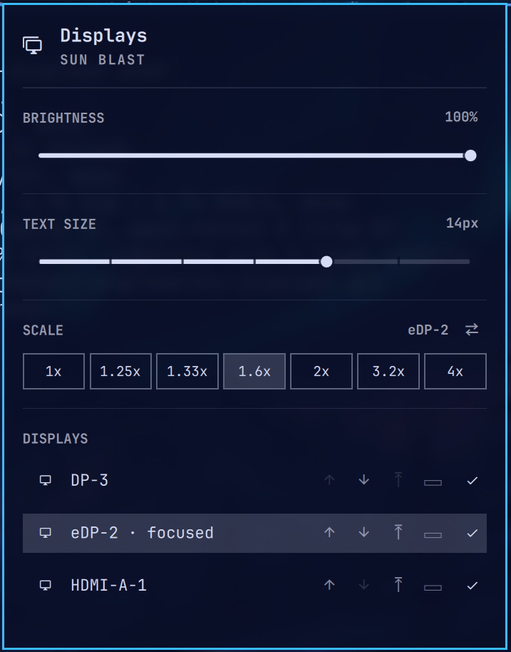

# Displays

The stock Omarchy **Display** panel, made to work with every monitor you have plugged in.

**It stays simple on purpose.** Same look, same place on the bar, same brightness and
text-size controls. No new windows, no settings page, no layout canvas to drag around, no
extra packages: just a few small buttons on the list that's already there. What it adds:

- **Scale any monitor.** The stock panel only scales the monitor under the mouse. Here you
  pick the monitor first.
- **Arrange them.** Change the left-to-right order.
- **Stack them.** Put one monitor above another.
- **Portrait or landscape.** One click per monitor.

Every change is saved to `~/.config/hypr/monitors.lua`, so it survives a reboot, and the
monitors are lined up again each time so they never overlap or leave a gap.



Built against Omarchy 4.5.0 (Hyprland 0.56.2, Quickshell 0.3.2). Forked from the stock
`omarchy.monitor` panel.

## Install

```bash
omarchy plugin add https://github.com/matthewjaybarr-png/omarchy-displays.git
omarchy plugin enable matthewjaybarr.displays
omarchy bar put matthewjaybarr.displays --after omarchy.monitor
omarchy plugin disable omarchy.monitor
```

Plugins land disabled so you can read the code first; `enable` is the second step on
purpose. The last two lines put Displays on the bar where the stock Display icon was and
turn the stock one off. Turning it off also lets Displays answer the brightness keys,
which call the panel by the stock name.

To go back: `omarchy plugin enable omarchy.monitor` and
`omarchy plugin disable matthewjaybarr.displays`.

## Using it

Click the monitor icon on the bar.

**Scale.** The name next to **SCALE** is the monitor the buttons change. Click it (⇄) to
step through your monitors, then pick a scale. There's a 1.33× button for 1080p screens.

**Displays list.** The list is in screen order: the top row is the leftmost monitor. Each
row has:

| Button | Does |
|---|---|
| ↑ / ↓ | move the monitor one place left / right |
| ⤒ | stack it above the monitor listed before it; bright when on, click again to undo |
| ▭ / ▯ | landscape / portrait; shows which it is now |
| click the name | turn the monitor on or off, same as stock |

A stacked monitor sits centred above the one before it in the list. To put a monitor above
your laptop, move it to just after the laptop with ↑ / ↓, then press ⤒.

**Brightness** still follows the monitor your mouse is on, same as stock.

## How it saves

`layout.py` (Python 3, standard library only) does all the writing:

- It changes only the `hl.monitor({ output = "NAME", ... })` line of each monitor, one line
  each. Monitors that don't have a line yet get one added at the end of the file. Your other
  lines are left alone.
- The previous file is kept as `~/.config/hypr/monitors.lua.bak-panel`. Copy it back over
  `monitors.lua` to undo the last change.
- Monitors are told apart by connector name (`HDMI-A-1`, `DP-3`, ...), not by model, so two
  identical monitors work fine. If you swap cables between ports, the two swap places.

Check the maths with `./layout.py --self-test`.

## License

MIT. Includes code from Omarchy's `omarchy.monitor` panel, also MIT.
